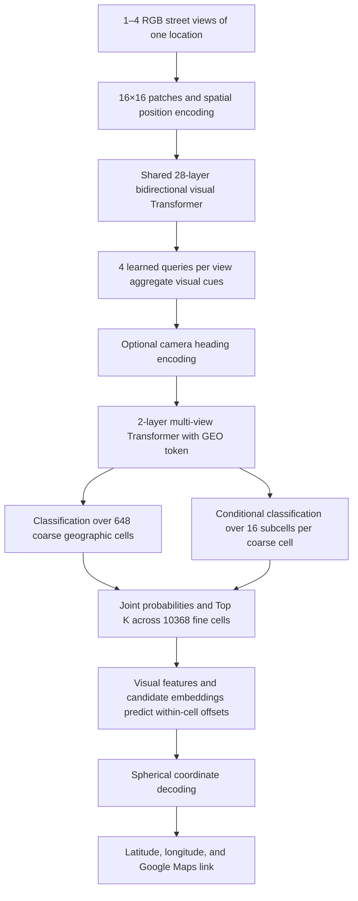

# Street-View Geolocation Transformer (S.V.G.T.)

**Street-View Geolocation Transformer**, abbreviated **S.V.G.T.**, converts local street-view images into geographic locations. It outputs decimal coordinates accepted by Google Maps: `latitude, longitude`, for example `34.052200, -118.243700`. This example illustrates the format only.

The default model has **397,937,418 parameters and approximately 1.48 GiB of FP32 weights**: width 1024, 16 attention heads, 28 visual layers, and 2 fusion layers. The default single-view training batch size is 32 with BF16 on CUDA. Configuration: `configs/streetgeo_400m.json`. Training accepts only OpenStreetView-5M, including partial image downloads. GSV-Cities, standalone Mapillary, mixed-source, and custom JSONL training inputs are rejected. This architecture requires a new training run in `checkpoints/streetgeo_400m_osv/`. Existing models remain usable with their saved architecture; the previous 134,686,730-parameter configuration is retained in `configs/streetgeo_514m.json`. See the [training guide](docs/STREETGEO_TRAINING.md). Model size and short capacity checks do not establish localization accuracy.

In the training workbench, select **模型规模** when creating a new run: **1.35 亿参数（原版 · 514 MiB）** uses `configs/streetgeo_514m.json` with suggested batch 64; **3.98 亿参数（新版 · 1.48 GiB）** uses `configs/streetgeo_400m.json` with suggested batch 32. Both use single-view 224×224 inputs and BF16 on CUDA. Switching presets selects separate output directories and clears incompatible initial weights. Custom JSON configurations remain supported. Exact resume uses the checkpoint's saved architecture and training settings.

The official project name is **Street-View Geolocation Transformer (S.V.G.T.)**. The Python package `streetgeo`, command names, and existing configuration/checkpoint paths are retained for compatibility with saved models and training runs. All runtime code is in `streetgeo/`, launched with `python -m streetgeo <command>`. See [project structure](docs/PROJECT_STRUCTURE.md) for directories and commands. The two root `.bat` launchers open the training workbench and prediction map. Both windows use a dark theme, including forms, dropdowns, logs, charts, and the offline map. Restart an existing window to load updates. Map resources are in `assets/maps/`; model configurations are in `configs/`.

```powershell
.venv\Scripts\python.exe -m streetgeo --help
.venv\Scripts\python.exe -m streetgeo gui
.venv\Scripts\python.exe -m streetgeo map
```

## Distributing the prediction client

`clinet/` is a bilingual Windows client for selecting a local S.V.G.T. model file, choosing street-view images, and viewing map predictions. The selected model path and language are remembered locally. The distribution ZIP contains application files and offline maps only: **model weights are never included** and must be shared separately. The client opens normally without a model; users choose a `.pt`, `.pth` or `.ckpt` file in the top model-path field. Chinese/English switching preserves images and predictions. The client also includes attention heatmaps, manual occlusion and explanation PNG export, with a bilingual explanation window. Training, device settings, manual coordinates, test-set evaluation and screenshot calibration remain in the developer tools. Launch with `Launch Client.bat` or `启动客户端.bat`; first-time setup requires Internet and 64-bit Python 3.10–3.15. See the [client README](clinet/README.md).

The client is generated from project code. The builder preserves existing local model files but excludes them from its automatically generated ZIP, along with `.runtime` and private settings. After changing prediction code, regenerate the client and archive with:

```powershell
.venv\Scripts\python.exe -m streetgeo build-client --output clinet
```

## Architecture



- LayerNorm, residual connections, attention, and feed-forward networks are retained from the original Transformer. Text vocabulary, BPE, and causal masking are removed, allowing image regions to attend to each other.
- Each view defaults to `224×224`, with width 1024 and 16 attention heads of 64 dimensions each. Views are encoded independently before fusion.
- Inputs may be `[B, 3, H, W]` or `[B, V, 3, H, W]`, with a `view_mask` for variable view counts. All views must depict the same location. View indices are not treated as compass directions without absolute headings. Supplied headings use sine, cosine, and a known-heading indicator.
- Equal-area geographic cells divide `sin(latitude)` and longitude uniformly. They are not countries or administrative regions. The default coarse grid is `18×36`, with `4×4` subcells in each cell, and requires no external boundary files.
- Joint probability is `P(coarse cell | image) × P(subcell | coarse cell, image)`. All fine cells are ranked without early pruning. Offsets are predicted separately for each candidate; distant coordinates are not averaged together.
- `tanh` constrains continuous offsets to their candidate cells. Decoding yields latitude in `[-90,90]` and longitude in `[-180,180)`. Spherical operations handle the date line; geometry uses FP64 to preserve polar precision.
- Training combines coarse-cell cross entropy, subcell cross entropy conditioned on the true coarse cell, within-cell Smooth L1, and unit-sphere chord distance. Offset training uses the true cell so early classification errors do not block learning. Validation uses predicted cells and reports spherical distance errors.
- `embedding` exposes normalized visual features for future place retrieval. A retrieval database, dedicated OCR branch, road matching, and pretrained-model loading are not currently implemented.

Cells provide discrete location hypotheses; within-cell regression produces continuous coordinates. Grid resolution alone does not imply street-level accuracy. Raw 360° equirectangular panoramas are not automatically projected into perspective views. Supply perspective street views in several directions instead. Increasing `image_size` may help high-resolution sign tasks but increases attention computation.

## Environment and verification

Python 3.12 is recommended. In Windows PowerShell:

```powershell
uv venv --python 3.12 .venv
uv pip install --python .venv\Scripts\python.exe -r requirements.txt
.venv\Scripts\python.exe -m streetgeo train --smoke-test --device cpu
.venv\Scripts\python.exe -m unittest discover -s tests -v
```

`--smoke-test` checks the forward pass, loss, backward pass, and coordinate output with a small model and random images. It does not save weights or evaluate localization. Install a PyTorch build appropriate for your CUDA environment. `--device auto` uses CUDA when available and otherwise falls back to CPU.

## Local training data

Workbench page 01 imports **OpenStreetView-5M only**. Select its extracted root containing `train.csv` or `train/train.csv`. The importer matches CSV string IDs to local filenames, streams coordinate records, skips undownloaded images, and reports their count. Only the official training partition is imported. Capture sequences and geographic blocks are grouped with nearby samples excluded across splits. After adding images, use a new output directory rather than changing data for an active run.

```powershell
.venv\Scripts\python.exe -m streetgeo prepare --dataset-root data/OpenStreetView-5M --output-dir data/world_osv_514m
.venv\Scripts\python.exe -m streetgeo train --train-manifest data/world_osv_514m/train.jsonl --val-manifest data/world_osv_514m/val.jsonl --model-config configs/streetgeo_400m.json --output checkpoints/streetgeo_400m_osv/best.pt --epochs 4 --batch-size 32 --num-workers 4 --device cuda --amp bf16
```

The importer generates `train.jsonl`, `val.jsonl`, `test.jsonl`, and a split report. These JSONL files are internal OSV-5M training inputs, not a general-purpose dataset interface. Every training and validation record must identify `source` as `OpenStreetView-5M`, retain its string `osv5m_id`, and point to the matching single image. Training checks every record, including when resuming; unrelated or mixed manifests are rejected before model training begins. Use the importer rather than manually converting other datasets into this format.

Images receive EXIF orientation correction, RGB conversion, aspect-preserving resizing with padding, and normalization. Horizontal flipping is disabled to preserve driving-side and text cues. Independent validation uses location/sequence grouping and geographic separation. With validation data, the best model is selected by median validation distance; otherwise it is selected by training loss.

Checkpoints include their model configuration. Existing trained weights may still initialize a new OSV-5M stage using `--init-from`, provided the architecture matches. Existing inference models remain usable. Exact resume requires unchanged OSV-5M training/validation manifests; old runs using other datasets are rejected. `--model-config custom.json` overrides model settings; see `streetgeo/core/config.py`.

Training periodically writes checkpoints atomically and retains the preceding full state. For example, an output named `checkpoints/streetgeo.pt` uses `checkpoints/streetgeo.last.pt` and `streetgeo.last.previous.pt`. Press Ctrl+C once to finish the current batch, save, and exit. After power loss or forced termination, resume the latest committed state:

```powershell
.venv\Scripts\python.exe -m streetgeo train --resume checkpoints/streetgeo.last.pt
```

Resume state includes the optimizer, AMP scaler, random generators, learning-rate progress, epoch, and next batch. CPU interruption tests are tensor-for-tensor identical to continuous training with the same data, settings, and execution environment. GPU operations may be nondeterministic; cross-device or cross-version bitwise equality is not guaranteed. See the training plans for recovery constraints.

## Inference and Python API

### Immediate learning from map corrections

The developer prediction map now supports **点选真值并学习**: after predicting your own game image, zoom in and click the actual location revealed by the game. A few supervised steps update the geographic heads of a separate personal checkpoint; the visual encoder remains frozen and up to 256 past feedback locations provide bounded replay. The next prediction uses the personal model automatically. The base model remains intact, and **撤销上次学习** restores the preceding update or switches back to the base model. Personal weights and local feedback stay outside distribution archives. This is unvalidated adaptation, not a guarantee of improved accuracy after each click. Official test images are blocked from learning. Ordinary offline training remains OSV-5M-only; human feedback has a separate training entry point. See [the online learning guide](docs/ONLINE_LEARNING.md).

### Local prediction map

Open the root prediction-map `.bat` launcher, select page 03 in the training workbench, or run:

```powershell
.venv\Scripts\python.exe -m streetgeo map
```

1. Import 1–4 perspective views of the same location, select a trained visual checkpoint such as `checkpoints/us_pilot/best.pt`, and start prediction. Both best-weight files and full resume checkpoints support inference. Weights load on the first prediction and are reused until the file changes.
2. By default, predictions rank geographic cells worldwide, independently of map position or zoom. Enable **仅 Google 官方街景覆盖国家／地区** to restrict coordinates using the offline country/region allowlist; the selection is remembered in both the testing app and bilingual client. Partial coverage is included, and individual roads are not verified. The window returns to a global overview after each result. Selecting a candidate updates its highlight; use the locate-candidate button to inspect it locally. Grid probabilities retain their original global values and are not calibrated correctness estimates. See [prediction coverage](docs/PREDICTION_COVERAGE.md) for scope, metadata and CLI usage.
3. The offline world map uses **UN Geospatial / OCHA country polygons and boundary lines**, including source geometry and labels for China. Source line styles distinguish solid and dashed boundaries; Census US state boundaries are also included. The source does not imply UN endorsement of boundaries or territorial status. Optional online roads use independent OpenStreetMap tiles and their boundary depiction. Tiles follow HTTP cache lifetimes and are not prefetched in bulk. Only tile-location requests leave the machine; street-view images and inference remain local. See [map resources](assets/README.md).
4. Before training, use manual coordinates in `latitude, longitude` format to test markers and screenshot projection. Manual results are labeled as such; random predictions are not substituted for trained results.

**Random official-test evaluation:** Select a checkpoint and click the random-test prediction button. The default directory is `data/OpenStreetView-5M/test`; the test-directory button can select another folder containing `test.csv`. The sampler matches exact string IDs to extracted local images in test shard directories or the official `images/test` layout, skips unavailable images and invalid coordinates, and samples uniformly among matching IDs. It never samples from the training directory or downloads images. A gold truth marker and numbered prediction markers are shown on the global map. The comparison panel reports actual coordinates, the selected candidate's coordinates/distance, and the top-1 great-circle error in kilometers. Selecting another candidate updates its error. Exported JSON includes `ground_truth`, `top1_error_km`, and each candidate's `error_km`. Ground-truth labels are used only after inference and are not supplied to the model. Changing/clearing images removes the test comparison. After adding image shards to a previously scanned folder, select the test directory again to refresh its index. A single random sample is a spot check, not a dataset-wide accuracy estimate.

**Full official-test evaluation (developer testing app only):** In `Prediction.bat`, select a checkpoint, device and test directory, then click **运行全部 test**. This freshly scans `test.csv` and evaluates every matching local test image once, as independent single-image samples in batches (default 16; reduce Batch if GPU memory is insufficient). It loads one fixed model for the run, uses the same preprocessing as interactive prediction, and never updates weights. The window shows progress, throughput and estimated time remaining; **停止并保存统计**, or closing the window, stops after the current load/batch and saves a partial report.

**Prediction explanation (testing app and distributed client):** Import 1–4 images of the same location, select a checkpoint/device, then click **查看关注区域 / 遮挡分析** in the testing app or **关注区域 / 遮挡分析** (**Attention / occlusion**) in the CPU client. The separate window shows each view's learned pooling-query attention (averaged over attention heads), individual query maps or their mean, with adjustable overlay opacity. It uses the unchanged model forward and removes its temporary inspection hook after success, cancellation or failure. Model letterbox padding is removed before projecting the map onto the EXIF-oriented original; window resizing preserves the picture aspect ratio. Colors are independently normalized per map: blue is weaker and red stronger, not calibrated importance or a causal explanation. These are contextual patch features, so attention at a position can already contain information from other positions.

Drag a rectangle on the original image and click **运行框选遮挡**. The experiment replaces that region with gray in the model input, leaving other views unchanged. It reports original/new Top-1 coordinates, their separation (not ground-truth error), and the before/after probabilities of the **same original candidate cells**, including cells that leave the new Top-5. The selected rectangle is rounded to actual model-input pixels. The masked-original preview is a region illustration, not the resized input tensor. A probability change is evidence of sensitivity to this perturbation, not proof of a unique visual cause. **导出 PNG** saves a fixed layout with the original, attention map, latest occlusion illustration for that view, and comparison statistics. Background analysis shares the interactive model cache, blocks simultaneous prediction/evaluation, and supports cancellation after the current model load/forward. Existing weights/images are never edited. Changing model or updating checkpoint requires refreshing attention before another occlusion experiment. This first version provides attention and manual occlusion; candidate-specific gradient attribution and automatic sliding occlusion are not implemented. The shared explanation UI/backend are included in distributed clients. Client language changes update the explanation controls, comparison text and PNG export language while preserving the current view, query, selection and results. Full-dataset test evaluation remains developer-only.

**Visual statistics:** **查看统计** opens chart tabs with a score histogram (including mean/median markers), distance-error bins, threshold accuracy, an empirical error CDF, country-level mean/median scores and test coverage counts. Country charts show the 15 groups with the most successful samples and label their sample sizes; every group remains in the detailed statistics. The CDF retains at most 512 actual rank points for large evaluations; all numerical statistics remain exact. Partial runs are labeled prominently. Charts support Matplotlib zoom/pan and **导出当前图表** to PNG/SVG. Every new run also writes `statistics_overview.png/.svg` and `statistics_countries.png/.svg` beside its CSV/JSON reports. **读取历史统计报告…** opens a saved `summary.json` and, for older reports, recovers chart aggregates from the adjacent `results.csv` without loading a model or running inference. Keep these two files together when moving old reports. Historical source reports are preserved. This developer-only feature requires Matplotlib from the root `requirements.txt`; the distributed client has no plotting dependency or evaluation features.

Chart windows retain the report's aspect ratio and a DPI-aware minimum readable size. Small or short windows scroll instead of squeezing labels together; use the scrollbars or mouse wheel (Shift + wheel for horizontal scrolling). The navigation toolbar stays below the chart viewport, and header buttons wrap when needed. Data zoom/pan keeps its current limits when the window is resized. Both export buttons save a fresh, full-size report layout while preserving the current data zoom, so window size does not distort the exported PNG/SVG.

Reports are saved separately under `.gui/evaluations/<run timestamp>/`: `report.txt` is readable, `summary.json` contains full statistics/provenance, `results.csv` contains each attempted image's ranked predictions, Top-1 distance/score or image-decode failure, and `excluded.csv` lists missing images, invalid IDs/coordinates and duplicate metadata rows. The report includes mean/median, minimum/maximum, population standard deviation, linearly interpolated percentiles, distance RMSE, accuracy within 1/25/200/750/2500 km, distance-bin counts, country-group statistics and a separately labeled best-of-five oracle distance. Scores follow a **GeoGuessr World approximation**: **5000 × exp(-Top-1 error in km / 1492.7)** rounded half-up to integer points for each image, with a maximum of **5000**, and 5000 awarded within 25 meters. Nearer guesses may also round to 5000. The decay scale follows [PIGEON, appendix F.1](https://arxiv.org/html/2307.05845v3#A6.SS1). GeoGuessr supports [custom map scoring radii](https://geoguessr.canny.io/changelog/patch-notes-21st-of-march), so this fixed global profile does not claim point-for-point equivalence with every live/custom map. Mean/median are calculated from per-image integer scores; totals and perfect-score counts are also reported. Score and distance statistics use successful samples only. Missing, invalid, failed and unprocessed cases are counted explicitly; partial local coverage is never labeled a complete official-test evaluation. No test labels are passed into the model. This feature and its evaluation modules are excluded from the distributed bilingual prediction client.

**Screenshot calibration and manual placement:** Import a saved game-map screenshot, for example one captured with Windows `Win+Shift+S`. Add corresponding points by selecting a recognizable location on the local map, then the same location in the screenshot. Use at least three pairs; four or more well-spread, non-collinear pairs are recommended. Use coastline corners or intersections rather than displaced text labels. The application fits an affine transformation in Web Mercator space and draws a crosshair for the selected candidate. Export a PNG at the screenshot's original size and place the marker in the game manually. The application does not control the game or submit guesses.

Both maps must be planar and use the same projection. Keep them north-up without tilt and calibrate within the same local area. Corresponding longitudes must span less than half the globe; local views near the date line are supported. Recalibrate after map movement, zooming, or window changes. Replacing the screenshot clears calibration. Off-screen suggestions are reported explicitly. Calibration error is measured in original screenshot pixels. Three points fit exactly and cannot validate accuracy; additional points check consistency but do not establish localization accuracy. Display scaling does not alter exported pixel coordinates. Calibration JSON can be saved and loaded; the original screenshot SHA256 is checked to prevent reuse with a different screenshot.

Inference runs in a background thread so the map remains responsive. Settings are stored in `.gui/prediction_settings.json`. Imported images, screenshots, and predictions are not saved by default. Closing the window during inference waits for that inference to finish.

After training `checkpoints/streetgeo.pt`:

```powershell
.venv\Scripts\python.exe -m streetgeo predict street.jpg
.venv\Scripts\python.exe -m streetgeo predict north.jpg east.jpg --headings 0 90 --top-k 5 --json
```

Default output is one `latitude, longitude` line. `--json` includes candidates, joint grid probabilities, and Maps links. Probabilities are raw model grid probabilities, are not calibrated correctness estimates, and are not renormalized within Top K.

```python
from streetgeo.core.checkpoints import load_model
from streetgeo.inference.predict import predict_images

model = load_model("checkpoints/streetgeo.pt", device="auto")
best = predict_images(model, ["street.jpg"], top_k=1)[0]
print(best.coordinates)
print(best.maps_url)
```

For tensor-based training, use `output = model(images, targets, view_mask=mask, headings=headings)`, where `targets` has shape `[B,2]` and contains `(latitude, longitude)`, then call `output.loss.backward()`. Images must use the normalization implemented by `load_image`.

The original text GPT vocabulary, tokenizer, text data, and text weights are not used for street-view prediction.

## Design references

Patch encoding follows the [Vision Transformer paper](https://arxiv.org/abs/2010.11929). Geographic classification and localization refinement are informed by the [PIGEON paper](https://arxiv.org/abs/2307.05845). This implementation uses its own fixed equal-area grid and continuous offset head; it is not a PIGEON reproduction. Output links follow the [Google Maps URLs documentation](https://developers.google.com/maps/documentation/urls/get-started).
