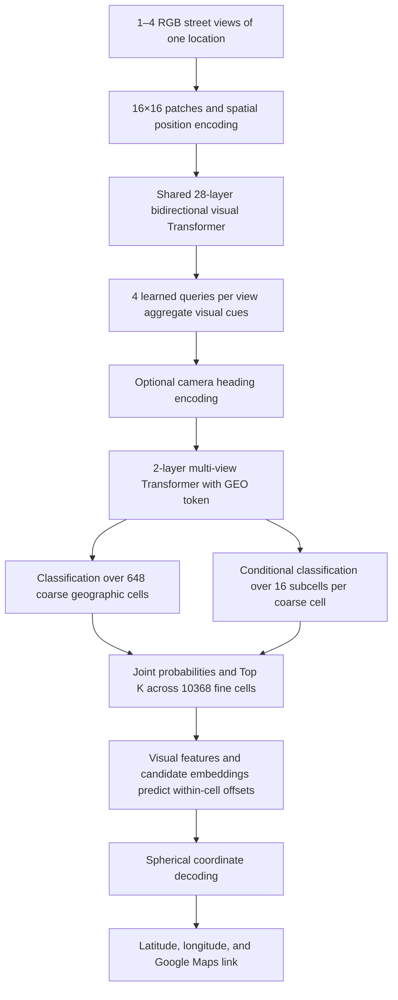

# Street-View Geolocation Transformer (S.V.G.T.)

[Model weights and Gradio demo on Hugging Face](https://huggingface.co/TheUserWW/S.V.G.T.-StreetViewGeolocationTransformer)

**Street-View Geolocation Transformer (S.V.G.T.)** estimates geographic coordinates from street-view images. The SigLIP2 NMPZ preset takes one fixed perspective image. The original presets accept up to four views of the same location. It returns latitude and longitude, such as `34.052200, -118.243700`, along with ranked geographic candidates.

This repository provides the PyTorch model, Mapillary data tools, and command-line training and resume interfaces. Model weights and datasets are distributed separately from the source files.


## Model configurations

| Configuration | Parameters | FP32 weights | Single-view CUDA batch |
| --- | ---: | ---: | ---: |
| [Default 400M](configs/streetgeo_400m.json) | 397,937,418 | 1.48 GiB | 32 default |
| [Legacy 135M](configs/streetgeo_514m.json) | 134,686,730 | 514 MiB | 64 suggested |
| [SigLIP2 NMPZ](configs/streetgeo_siglip2_nmpz.json) | 103,376,138 | 394 MiB | 8 suggested |

All presets use `224×224` inputs and support BF16 training on CUDA. The default architecture uses width 1024, 16 attention heads, 28 visual layers, and 2 fusion layers. Use `--model-config` for a new run with a custom configuration. Checkpoints carry their saved architecture. Start a separate run when changing model dimensions.

## SigLIP2 NMPZ

The single-view encoder starts from Google's pretrained SigLIP2 Base/16/224. Four learned queries pool patch features from the same frame before the hierarchical geographic classifier and within-cell offset head. Training freezes the vision blocks by default. Optional great-circle label smoothing and terminal-block fine-tuning are available from the CLI. See the [upstream backbone](https://huggingface.co/google/siglip2-base-patch16-224) and [NMPZ training guide](docs/training/mapillary.md#siglip2-nmpz-单图训练).

### Climate auxiliary experiment

Enable the five-class Köppen–Geiger auxiliary objective with `--climate-loss-weight 0.1`. Raster labels below 80% confidence or with missing data only contribute to the geolocation loss. The auxiliary head is used for training and evaluation. The released checkpoints predict locations through the geographic head.

| Climate loss weight | Top-1 median ↓ | P90 distance ↓ | Within 25 km ↑ | True cell in Top 5 ↑ |
| --- | ---: | ---: | ---: | ---: |
| `0` | 949 km | 3,501 km | 3.64% | 30.55% |
| `0.1` | 1,178 km | 3,602 km | 3.64% | 25.82% |

The two validation-selected checkpoints were evaluated on the same 275 held-out Mapillary images from North and Central America. Both runs used a frozen SigLIP2 encoder, four epochs, seed 1337, and hard geographic labels. At the matched final step (1,100), median distance was 926 km for `0` and 969 km for `0.1`. This is a single regional split with one training seed. The test set had valid climate labels for A, C, and D. The climate loss defaults to `0`.

The [Hugging Face model card](https://huggingface.co/TheUserWW/S.V.G.T.-StreetViewGeolocationTransformer) links to the SigLIP2 NMPZ checkpoint and both climate experiment checkpoints.

## Original visual architecture



- LayerNorm, residual connections, attention, and feed-forward networks are retained from the original Transformer. Text vocabulary, BPE, and causal masking are removed, allowing image regions to attend to each other.
- Each view defaults to `224×224`, with width 1024 and 16 attention heads of 64 dimensions each. Views are encoded independently before fusion.
- Inputs may be `[B, 3, H, W]` or `[B, V, 3, H, W]`, with a `view_mask` for variable view counts. All views must depict the same location. View indices are not treated as compass directions without absolute headings. Supplied headings use sine, cosine, and a known-heading indicator.
- Equal-area geographic cells divide `sin(latitude)` and longitude uniformly. Their boundaries follow the grid independently of political borders. The default coarse grid is `18×36`, with `4×4` subcells in each cell, and requires no external boundary files.
- Joint probability is `P(coarse cell | image) × P(subcell | coarse cell, image)`. The model ranks all fine cells and predicts a separate offset for each candidate.
- `tanh` constrains continuous offsets to their candidate cells. Decoding yields latitude in `[-90,90]` and longitude in `[-180,180)`. Spherical operations handle the date line; geometry uses FP64 to preserve polar precision.
- Training combines coarse-cell cross entropy, subcell cross entropy conditioned on the true coarse cell, within-cell Smooth L1, and unit-sphere chord distance. Offset training uses the true cell so early classification errors do not block learning. Validation uses predicted cells and reports spherical distance errors.
- `embedding` exposes normalized visual features that can be used for place retrieval.

Cells provide discrete location hypotheses; within-cell regression produces continuous coordinates. The model takes perspective street views. Project any raw 360° panorama into perspective views before using it. Increasing `image_size` may help high-resolution sign tasks but increases attention computation.

## Environment and verification

Python 3.12 is recommended. Create and activate a virtual environment, then install the dependencies and a PyTorch build appropriate for your system.

```sh
python -m pip install -r requirements.txt
python -m streetgeo --help
python -m streetgeo train --smoke-test --device cpu
python -m unittest discover -s tests -v
```

The smoke test exercises the forward pass, loss, backward pass, and coordinate output with a small model and random inputs. Use `python -m streetgeo check-gpu --help` for CUDA capacity checks. `--device auto` uses CUDA when available and otherwise uses CPU.

## Local training data

The training pipeline accepts perspective imagery downloaded through the official Mapillary API. Get a token from the [Mapillary developer portal](https://www.mapillary.com/dashboard/developers). `--prompt-token` reads it without echoing it. The CLI also reads `MAPILLARY_ACCESS_TOKEN` from your local environment.

```sh
python -m streetgeo download --list-regions
python -m streetgeo download --prompt-token --countries CHN,JPN --output data/mapillary_asia --max-images 10000
python -m streetgeo download --prompt-token --continents europe --output data/mapillary_europe
python -m streetgeo prepare --dataset-root data/mapillary_asia --output-dir data/world_mapillary
python -m streetgeo train --train-manifest data/world_mapillary/train.jsonl --val-manifest data/world_mapillary/val.jsonl --model-config configs/streetgeo_400m.json --output checkpoints/streetgeo_400m_mapillary/best.pt --epochs 4 --batch-size 32 --num-workers 4 --device cuda --amp bf16
```

The training command can also download, split, and train in one invocation.

```sh
python -m streetgeo train --download --prompt-token --countries JPN --download-output data/mapillary_japan --data-output data/mapillary_japan_split --max-images 10000 --model-config configs/streetgeo_400m.json --output checkpoints/streetgeo_400m_mapillary/japan.pt --batch-size 32 --device cuda --amp bf16
```

The downloader supports continents, countries or regions, US states, and a custom WGS84 polygon or bounding box. Named selections are combined by union. A polygon or bounding box further restricts the selection. Bounding boxes use `WEST SOUTH EAST NORTH`. The [geographic reference data](assets/README.md) supports these filters.

Download targets include already saved images. SQLite retains image IDs, pagination cursors, and failures. Temporary errors use bounded retries, and oversized queries can be subdivided geographically. Resume a download with the same selection and quality settings. The [Mapillary training guide](docs/training/mapillary.md) covers API limits, custom regions, and the `split` command for existing manifests.

### Data splits and validation

The importer creates frozen `train.jsonl`, `val.jsonl`, `test.jsonl`, and a split report. It groups samples by sequence and geographic block and excludes nearby cross-split samples. Each training and validation record must have `source: Mapillary`, a numeric string `mapillary_id`, and a matching image filename. Prepare into a new output directory when you add images during an active run.

Preprocessing applies EXIF orientation, RGB conversion, and checkpoint-specific resizing and normalization. The original architecture pads to a square. SigLIP2 NMPZ resizes the full image to 224×224. The pipeline preserves left-right cues such as driving side and text. Validation reports geographic distance errors. The best checkpoint is selected by median validation error when a validation set is supplied and by training loss otherwise.

### Checkpoints and resume

Use `--init-from` to start a new training stage from compatible weights. Exact resume requires the same training and validation manifests. Training writes checkpoints atomically and retains the previous full state. For an output named `checkpoints/streetgeo.pt`, the full state is `checkpoints/streetgeo.last.pt` and its preceding version is `checkpoints/streetgeo.last.previous.pt`.

Press Ctrl+C once to finish the current batch and save. Resume from the latest complete state with the following command.

```sh
python -m streetgeo train --resume checkpoints/streetgeo.last.pt
```

Resume restores the optimizer, AMP scaler, random generators, learning-rate progress, epoch, and next batch. The CPU interruption test checks tensor-for-tensor agreement with a continuous run under the same conditions. GPU reproducibility can vary across devices and versions.

### Environment fine-tuning

`--environment-specialist` alternates full views and bottom-trapezoid masked views for each batch. Start with a compatible checkpoint and a separate Mapillary validation manifest. By default, the final two visual blocks and the downstream pooling, fusion, and geolocation layers are trainable. The mask defaults to a top width of 20%, a bottom width of 100%, and a height of 45% of the source image. The run records both validation modes and selects the best checkpoint by full-view median error. The full checkpoint records the mask dimensions and next phase for resume. See the [environment fine-tuning guide](docs/training/mapillary.md#环境专项微调全图与底部梯形遮挡交替).

## Python model API

Create a `StreetGeoModel` from `streetgeo.core.model` or load a compatible checkpoint with `streetgeo.core.checkpoints.load_model`. Prepare images with the normalization in `streetgeo.datasets.images.load_image`. For tensor-based training, pass `(latitude, longitude)` targets of shape `[B, 2]`. `view_mask` and `headings` are optional.

```python
output = model(images, targets, view_mask=mask, headings=headings)
output.loss.backward()
```

The model output includes coordinates, candidate cell probabilities, and a normalized visual embedding. The probabilities represent the model distribution over geographic cells. A candidate's grid probability and its empirical localization accuracy are separate quantities.

## Source layout

- [`streetgeo/core/`](streetgeo/core/) contains the model, geographic grid, configuration, and checkpoint I/O.
- [`streetgeo/datasets/`](streetgeo/datasets/) contains image preprocessing, Mapillary collection, and dataset splitting.
- [`streetgeo/training/`](streetgeo/training/) contains training, validation, fine-tuning, and resume logic.
- [`docs/training/`](docs/training/) contains the Mapillary guide and regional training notes.
- [`tests/`](tests/) contains the headless model, dataset, and training tests.

## Design references

Patch encoding follows the [Vision Transformer paper](https://arxiv.org/abs/2010.11929). Geographic classification and localization refinement are informed by the [PIGEON paper](https://arxiv.org/abs/2307.05845). S.V.G.T. uses a fixed equal-area grid and a continuous offset head. Coordinate links follow the [Google Maps URLs documentation](https://developers.google.com/maps/documentation/urls/get-started).
